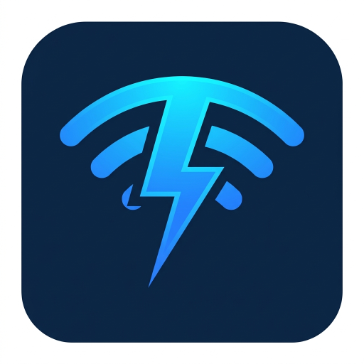

<div align="center">

  

  # SendSnap
  ### Lightning-Fast Offline P2P File Sharing

  [](https://flutter.dev)
  [](https://dart.dev)
  [](https://youssef0356.github.io/sendsnap_website/)
  [](https://youssef0356.github.io/sendsnap_website/)
  [](LICENSE)

  <p>
    <b>SendSnap</b> is an ultra-fast, privacy-first peer-to-peer file transfer application designed for <b>Android</b> and <b>Windows PC</b>.<br/>
    Transfer gigabytes of photos, 4K videos, documents, and folders at up to <b>100 MB/s</b> with <b>zero internet or cellular data usage</b>.
  </p>

  <p>
    <a href="https://youssef0356.github.io/sendsnap_website/">
      
    </a>
    &nbsp;
    <a href="https://play.google.com/store/apps/details?id=com.the356company.sendsnap">
      
    </a>
    &nbsp;
    <a href="https://youssef0356.github.io/sendsnap_website/downloads/sendsnap-windows-x64.zip">
      
    </a>
  </p>

</div>

---

## ⚡ Highlights

- 🚀 **Gigabit Local Speeds**: Transfer at up to **100 MB/s** using high-frequency local Wi-Fi or Personal Hotspot.
- 📴 **100% Offline & Private**: Zero cloud uploads, zero account registration, and zero data tracking. Files transfer directly between devices.
- 💻 **True Cross-Platform**: Share files effortlessly between **Android** and **Windows PC** with native high performance.
- 🃏 **Interactive Multi-File Cards Tray**:
  - View selected files as physical cards with **live image thumbnails** and file type badges.
  - **Drop file-per-file** onto specific devices and continue sending remaining files seamlessly.
  - Grab the **`DRAG ALL`** header handle to send the entire queue in an elevated 3D batch deck.
- 🌌 **Segmented Edge Portal Dock**: Drag files directly to the screen bezel with ethereal feathered radial aura glows for tactile AirDrop-like drops.
- 📷 **Instant QR & Manual IP Connect**: One camera scan connects devices immediately; fallback direct IP socket pairing connects across complex corporate/campus subnets.
- 📲 **System Integration**:
  - **Android**: Supports native Android Share Sheet (`SEND` / `SEND_MULTIPLE`) directly from file managers and photo galleries.
  - **Windows**: Explorer context menu integration (*"Send with SendSnap"*) and `SendTo` shortcut.
- 👁️ **Built-in Media Viewer**: Preview full-resolution photos with pinch-to-zoom and open documents directly in-app.

---

## 📥 Downloads

| Platform | Format | Link |
| :--- | :--- | :--- |
| **Android** | Google Play Store | [Get SendSnap on Google Play](https://play.google.com/store/apps/details?id=com.the356company.sendsnap) |
| **Windows (64-bit)** | Standalone Executable (.zip) | [Download `sendsnap-windows-x64.zip`](https://youssef0356.github.io/sendsnap_website/downloads/sendsnap-windows-x64.zip) |
| **Website** | Official GitHub Pages Site | [https://youssef0356.github.io/sendsnap_website/](https://youssef0356.github.io/sendsnap_website/) |

---

## 🛠️ Architecture & Tech Stack

- **Framework**: [Flutter](https://flutter.dev) (Dart 3.x) with custom platform channels
- **Discovery Protocol**: UDP Multicast broadcast over local subnet (Port `53317`)
- **Transfer Engine**: High-throughput multi-threaded TCP sockets (Port `53318`) with streaming chunk buffers
- **Drag & Drop**: Native desktop drag-and-drop (`desktop_drop`) and Flutter gesture physics
- **Design Language**: Frosted glassmorphism (`BackdropFilter`), ambient radial gradient orbs, and Apple-grade fluid typography

---

## 🚀 Building from Source

### Prerequisites
- Flutter SDK (v3.24+ recommended)
- Android Studio / Android SDK (for Android builds)
- Visual Studio 2022 with *Desktop development with C++* (for Windows builds)

### 1. Clone the repository
```bash
git clone https://github.com/Youssef0356/SendSnap.git
cd SendSnap/sendsnap
```

### 2. Install dependencies
```bash
flutter pub get
```

### 3. Run on connected device or desktop
```bash
# Run on Windows Desktop
flutter run -d windows

# Run on Android phone / emulator
flutter run -d android
```

### 4. Build Release Packages
```bash
# Build Android APK
flutter build apk --release

# Build Windows Release Executable (.exe)
flutter build windows --release
```
The Windows release executable is output to `build/windows/x64/runner/Release/sendsnap.exe`.

---

## 💬 Feedback & Support

- **Bug Reports & Feature Requests**: [Open a GitHub Issue](https://github.com/Youssef0356/SendSnap/issues)
- **Direct Developer Email**: [nejiyoussef081@gmail.com](mailto:nejiyoussef081@gmail.com)
- **Website**: [https://youssef0356.github.io/sendsnap_website/](https://youssef0356.github.io/sendsnap_website/)

---

<div align="center">
  <sub>Crafted with ❤️ by Youssef Neji • © 2026 SendSnap</sub>
</div>
